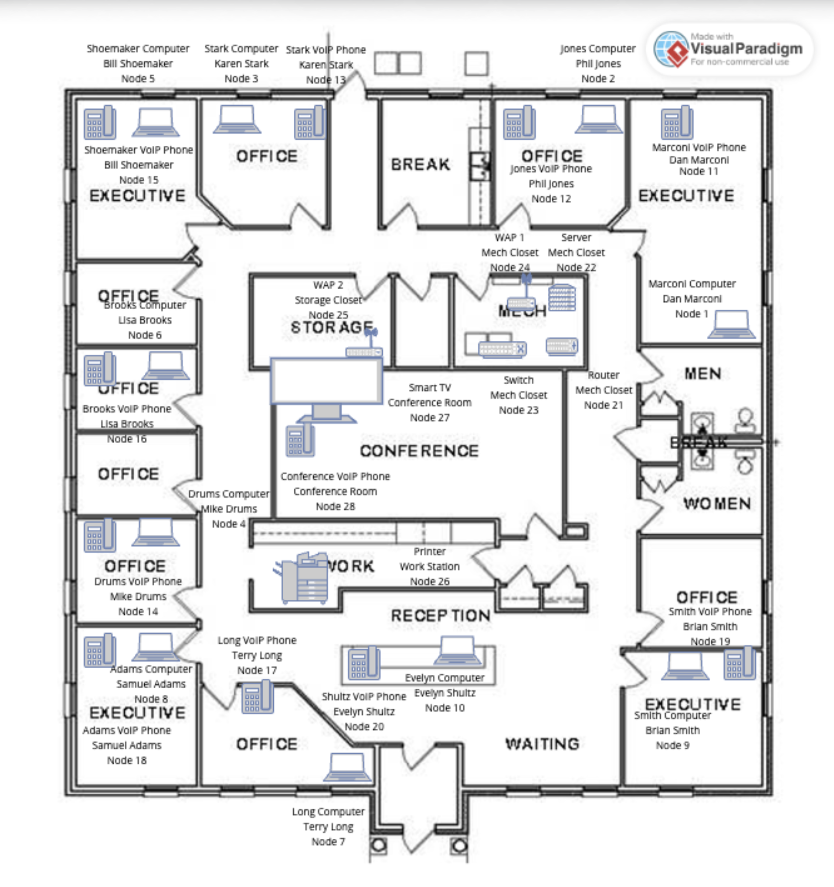
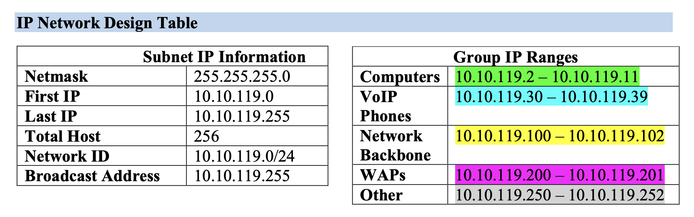
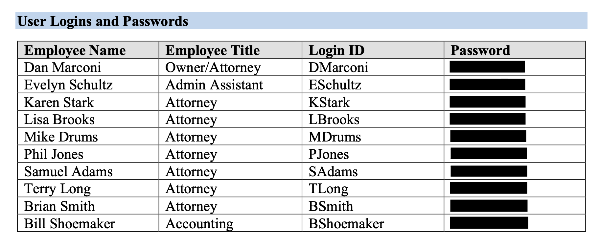
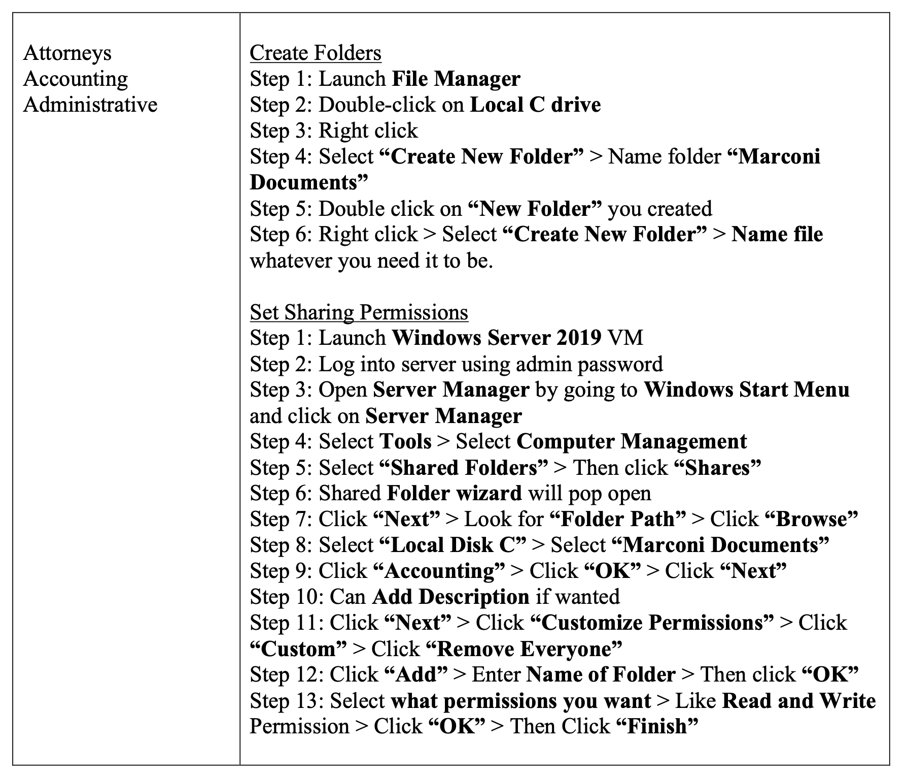
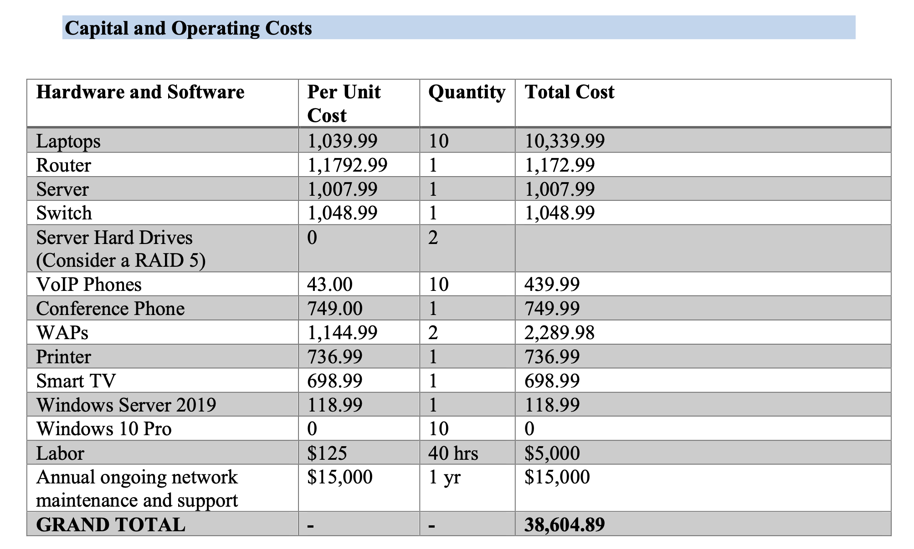
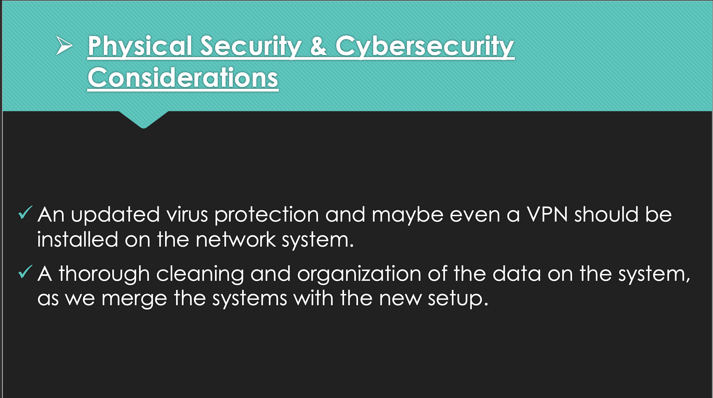

# Small Business Network & Windows Server Infrastructure Design

## Project Overview

This project focused on designing a small-business network and Windows Server environment for a law office preparing to move into a new location.

The goal was to create a more reliable and organized infrastructure that could support employee workstations, VoIP phones, wireless access points, shared files, server-based administration, and future business growth.

The project included physical and logical network planning, IP address design, Windows Server user and group structure, shared-folder permissions, hardware and software budgeting, and security considerations.

## Objectives

- Design a network for a small business office environment.
- Create an IP addressing plan for workstations, VoIP phones, infrastructure devices, and wireless access points.
- Plan Windows Server user accounts and departmental groups.
- Design shared-folder access and permissions.
- Map network equipment to the physical office layout.
- Develop hardware and software requirements.
- Estimate implementation and ongoing operating costs.
- Identify physical and cybersecurity considerations for the environment.

## Network Architecture

The office network was designed around the physical layout of the business.

The topology included employee workstations, VoIP phones, wireless access points, a server, router, switch, printer, conference-room devices, and other supporting equipment.

*Office network topology showing workstation, VoIP, server, wireless, switching, routing, and shared-device placement.*

## IP Network Design

The network used the `10.10.119.0/24` subnet.

Device ranges were organized by role to make addressing easier to manage and document.

Examples included:

- Computers: `10.10.119.2 - 10.10.119.11`
- VoIP phones: `10.10.119.30 - 10.10.119.39`
- Network backbone devices: `10.10.119.100 - 10.10.119.102`
- Wireless access points: `10.10.119.200 - 10.10.119.201`
- Other shared devices: `10.10.119.250 - 10.10.119.252`

*IP addressing plan showing subnet information and grouped address ranges for business devices.*

## Windows Server Account Structure

The Windows Server environment included user accounts based on employee roles and responsibilities.

Departmental groups were planned for areas such as:

- Attorneys
- Accounting
- Administrative staff

Grouping users by business role provided a more organized way to manage access to shared resources and permissions.

*User account and role design for the Windows Server environment. Passwords were redacted from the original lab documentation before publication.*

## Shared Folders and Permissions

The project included shared-folder planning for departmental data.

A central `Marconi Documents` location was designed with separate folders for business groups such as Attorneys, Accounting, and Administrative staff.

The documented permissions process included:

- Creating departmental folders
- Opening Windows Server shared-folder management
- Creating network shares
- Customizing permissions
- Removing broad default `Everyone` access
- Assigning appropriate users or groups
- Granting required Read or Write permissions

*Documented Windows Server shared-folder configuration process showing departmental folder creation and customized access permissions.*

## Hardware and Software Planning

The infrastructure design included planning for:

- Windows 10 Pro laptops
- Windows Server 2019
- Server storage
- Router
- Network switch
- Wireless access points
- VoIP phones
- Conference phone
- Printer
- Smart TV / conference equipment

The project also considered implementation labor and ongoing network support.

*Capital and operating cost estimate covering infrastructure equipment, software, labor, and ongoing support.*

## Security Considerations

Security planning was included as part of the overall network design.

Recommendations included maintaining updated endpoint protection and considering VPN access for appropriate network use.

The project also considered the importance of organizing and reviewing data during migration into the new infrastructure.

*Physical and cybersecurity considerations identified for the proposed business network.*

## Key Design Decisions

Several design choices were made to improve organization and manageability:

- Devices were assigned predictable IP ranges based on their role.
- Employee accounts were organized around business functions.
- Shared resources were designed around departmental access.
- Default broad permissions were replaced with more specific access assignments.
- Hardware and software requirements were planned before implementation.
- Security and maintenance requirements were included as part of the infrastructure design.

## Lessons Learned

- Network planning should account for both technical requirements and the physical layout of a business.
- Structured IP addressing makes networks easier to document and troubleshoot.
- Windows Server groups can simplify permission management.
- Shared-folder permissions should follow business roles rather than provide unnecessary broad access.
- Infrastructure projects require budgeting, hardware selection, and ongoing support planning in addition to technical configuration.
- Security should be included during the planning stage rather than added after the network is deployed.
- Clear documentation is important for future administration, troubleshooting, and expansion.

## Skills Demonstrated

- Small-business network design
- IP addressing and subnet planning
- Network topology development
- Windows Server administration planning
- User and group management
- Shared-folder and access-control planning
- Infrastructure documentation
- Hardware and software planning
- Cost estimation
- Physical security planning
- Cybersecurity planning
- Technical project documentation

## Project Scope Note

This project was completed in an authorized educational environment as a simulated business network implementation.

Names, account information, and network details shown in the original coursework were created for the lab scenario. Passwords and other credential information were removed from the public project documentation.